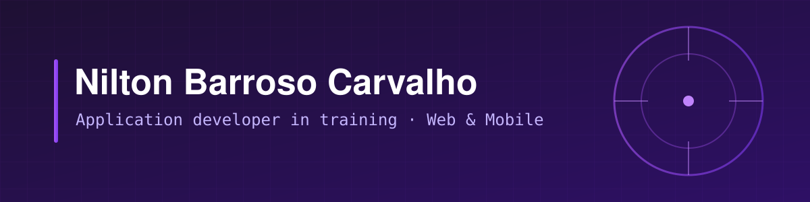
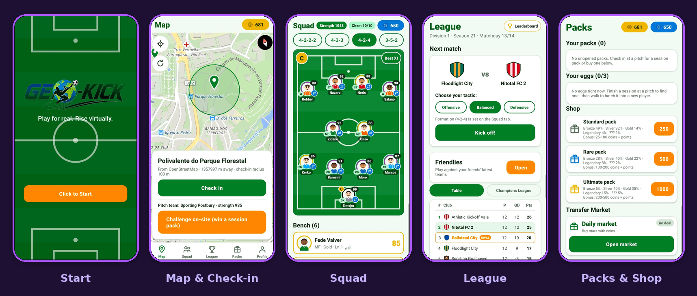
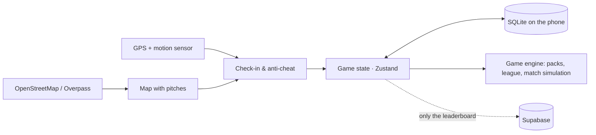
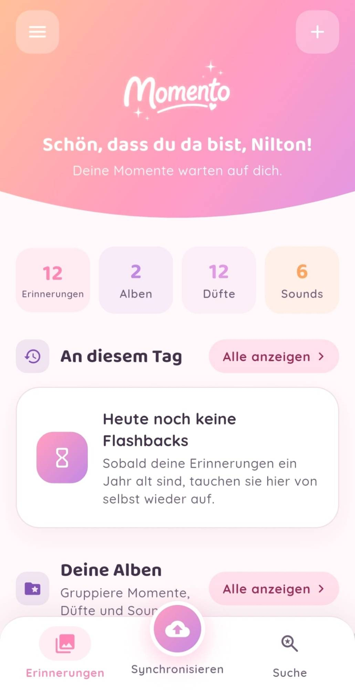

<p align="center">
  
</p>

## Yo Family 🫂

I'm Nilton, application developer in training from Bern. I like turning ideas into apps that actually run on a real phone, and I care more about *does it work* than about how many frameworks I can list.

```ts
const nilton = {
  location: "Bern, Switzerland",
  training: "Informatiker EFZ Applikationsentwicklung + Berufsmaturität",
  school: ["IMS bwd Bern", "gibb"],
  favouriteStack: ["TypeScript", "React", "React Native"],
  strongestAt: ["HTML", "CSS", "JavaScript", "SQL"],
  alsoWorkedWith: ["Flutter", "Dart", "Node.js", "C#", ".NET MAUI"],
  currentlyBuilding: "Pulsolux",
  nextStep: "internship year at SBV from August 2027",
};
```

---

## ⭐ Spotlight: Geo-Kick

**Play for real. Rise virtually.** A football game for Android where you check in at real pitches near you, collect players and lead your own club from Division 4 up to Division 1.

<p align="center">
  
</p>

- 📍 **GPS check-in** at real pitches from OpenStreetMap, only within a 100 m radius
- 🛡️ **Anti-cheat**: geofencing, fake-location detection and a motion sensor check
- 🃏 **Packs, squad and tactics** with formations, chemistry and a simulated league
- 📴 **Offline-first**: all game data lives on the phone, only the leaderboard goes online
- 🧪 **Tested game logic**: a script with 50+ automatic checks for rewards, schedules and simulation
- 🔨 **100+ commits** in about one month, built as my own project next to school

[**Repository**](https://github.com/notling09/Geo-Kick) · [**Download for Android**](https://geo-kick.vercel.app/)

<details>
<summary><b>How it's built</b></summary>
<br>



React Native · Expo · TypeScript · Zustand · SQLite · MapLibre · Supabase

</details>

---

## 💜 Built for my sister: Momento

My sister Dalila and three of her classmates wrote a full business plan for a memories app. It stayed on paper, so I built it. **Momento** saves not just a photo but the whole moment: the place, the people, the feeling, the scent and the sound.

<table>
<tr>
<td width="32%" valign="top">
  
</td>
<td valign="top">

- 📱 **One codebase** for Android, iOS and the web, built with Flutter and Dart
- 🎙️ **Real sounds**: record the moment directly with the microphone
- 🔒 **No server**: all data stays on the device
- 🔎 **Smart search** that understands synonyms and seasons and forgives typos
- 🧪 **~12,600 lines**, 54 files and 59 tests, in German and English, light and dark mode
- 🧠 **Three things I changed on purpose**: no ID photo at sign-up (Swiss data protection), scents from a palette instead of "measured", and no videos so the storage doesn't explode

Their idea, my code. Their names are in the app.

[**Website**](https://momento.niltonbc.ch): try it in your browser or download the app

</td>
</tr>
</table>

---

## 🔬 Right now: Pulsolux

A Flutter app that **measures your pulse with the smartphone camera**. Put your finger on the camera and flash, and the app reads the tiny changes in brightness with every heartbeat (photoplethysmography).

- Signal filtered with a 0.7–3.5 Hz band-pass, then peak detection, double-checked with an FFT
- Two modes: flash (reflection) or an external light (transmission)
- No internet, no diagnosis: all data stays on the phone
- Tested on Samsung S25 and iPhone 17 Pro, about 1–6 bpm off in first tests
- Next up: a measurement series with ~15 people against a pulse oximeter

Built as our IDPA at the IMS with Cat Tuong Nguyen and Luis Rosado.

---

## 🧭 My path so far

| When | What |
|---|---|
| **2024** | Started the IMS: application development + Berufsmaturität |
| **2025** | First apps in C#: a Snake game and a recipe app with .NET MAUI |
| **2026** | Full-stack web apps with React, Express and SQLite at school |
| **Summer 2026** | Built Geo-Kick, 100+ commits in about a month |
| **Autumn 2026** | Momento, my sister's business plan turned into a real app |
| **Autumn 2026** | Pulsolux, pulse measurement with the phone camera |
| **August 2027** | Internship year at **SBV** 🚀 |

<details>
<summary><b>📚 School projects</b></summary>
<br>

| Project | What it is | Stack |
|---|---|---|
| [2XKO Combo Trainer](https://github.com/notling09/2XKO-Timing-Trainer) | Build, save and practise fighting game combos with a timing trainer | React, TypeScript, Vite |
| [How to Survive](https://github.com/notling09/HowToSurvive-DaysOfTheWeek) | Full-stack app with login where users write and like tips for every weekday | React, Express, SQLite, JWT |
| [EnerGym](https://github.com/notling09/EnerGym) | Fitness tracker with progress charts, badges and a REST API | React, TypeScript, Express, SQLite |
| [CookEasy PT](https://github.com/notling09/CookEasyPT) | Recipe app for Portuguese dishes with favourites and a shopping list | C#, .NET MAUI |
| [Snake: Jungle Edition](https://github.com/notling09/SnakeGame-Jungle-Edition) | Classic Snake game for Windows | C#, WinForms |

</details>

---

## 🛠️ Tech


## ⚽ Fun facts

- I built a football game because I love football, so testing it means going outside to play
- Big Benfica fan 🦅 and yes, I built a website for them too
- My portfolio has Portuguese azulejo tiles in the design, because that's where my roots are
- I speak five languages: Portuguese, German, English, French and Spanish
- I once tried to build my own little operating system (DoorSystem96). It had way too many bugs in the end, and it taught me more than any project that worked
- My favourite part of coding is the moment a bug finally makes sense

## 📫 Contact

[](https://niltonbc.ch)
[](mailto:niltonbcarvalho09@gmail.com)
